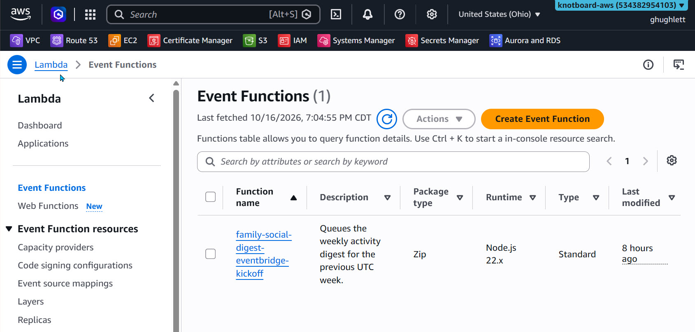
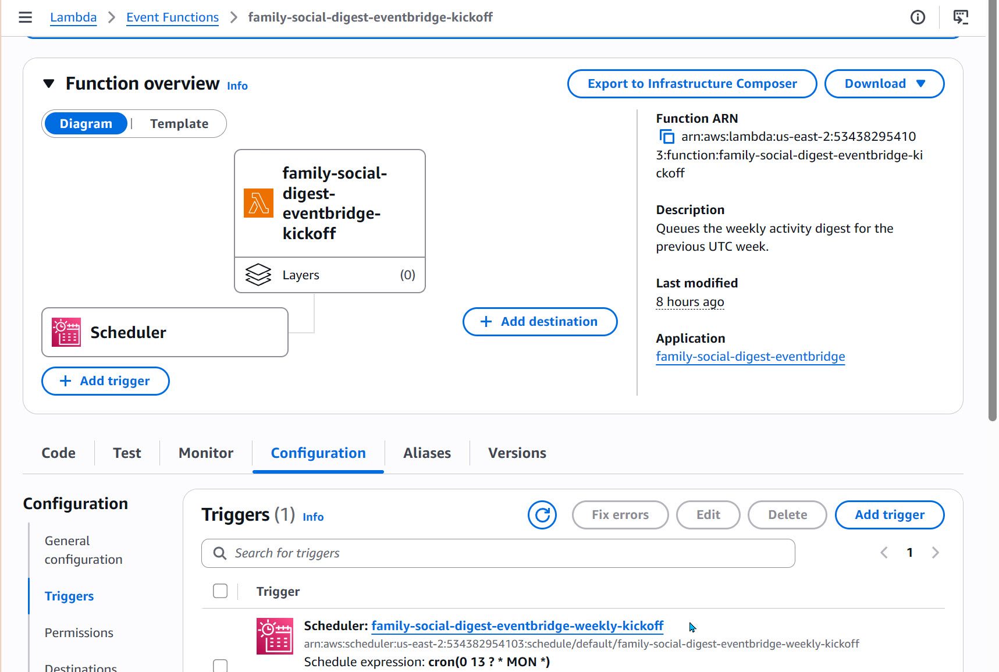
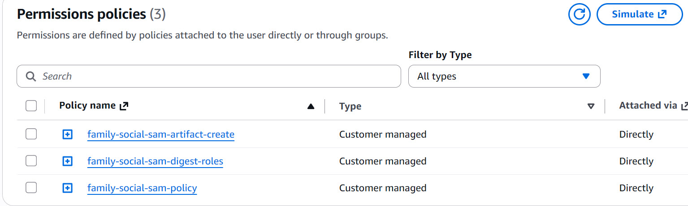

- [Setup](#setup)
- [Scheduled Kickoff (Lambda Scheduler)](#scheduled-kickoff-lambda-scheduler)
  - [How it works](#how-it-works)
  - [Files](#files)
  - [Prerequisites](#prerequisites)
  - [AWS Configuration](#aws-configuration)
    - [IAM User and associated policies](#iam-user-and-associated-policies)
  - [Local Configuration](#local-configuration)
  - [Build, validate, and deploy](#build-validate-and-deploy)
  - [Test after deploying](#test-after-deploying)
  - [Operations](#operations)
  - [Changing or removing the stack](#changing-or-removing-the-stack)
- [Troubleshooting SAM deployment](#troubleshooting-sam-deployment)

## Setup
This markdown topic addresses the setup on AWS of the scheduled Lambda that will execute each Monday to produce an activity digest for the week before. The focus will be on the AWS artifacts that have to be created to enable this, as well as the SAM deployment to create the triggered lambda that is defined in this project. 

## Scheduled Kickoff (Lambda Scheduler)

The scheduled triggers of the weekly activity digest **DO NOT** come from the EventBridge Scheduler, but instead from a Lambda event function in AWS. This component built for AWS is actually a Lambda function and not a rule in the AWS Event Bridge. It's a misnomer, but we're stuck with that naming convention. 

Shown below is the initial console entry in AWS. 



When the `family-social-digest-eventBridge-kickoff` is selected, the following screenshot shows where the scheduler actually lives. 



### How it works
A Lambda POSTs to the endpoint above every Monday for the previous UTC week. It is deployed with AWS SAM from [infra/digest-eventbridge](../../infra/digest-eventbridge/), along with retries, dead-letter queues, and CloudWatch alarms. Any future SQS fan-out is separate work.

```
EventBridge Scheduler  cron(0 13 ? * MON *) UTC
   │  input: {"scheduledTime": "<aws.scheduler.scheduled-time>"}
   ▼
Lambda  <stack>-kickoff  (src/index.mjs)
   │  POST {AppBaseUrl}/api/internal/weekly-activity-digest/run
   │  headers: x-fs-internal-secret (from SSM), x-fs-request-ts, x-fs-idempotency-key
   ▼
family_schema.family_activity_digest_run  (status = queued, trigger_source = eventbridge)
   ▼
EC2 digest worker (PM2: family-social-digest) processes the run and sends emails
```

- The Lambda queues the **previous** Monday 00:00Z – Sunday 23:59:59.999Z week. The week is derived from the schedule's `scheduledTime`, so retries always target the same week.
- The idempotency key is deterministic: `eventbridge-weekly-<weekStart yyyy-mm-dd>` (`-dryrun` suffix for dry runs). A duplicate invocation hits the run table's `UNIQUE (week_start_utc, kickoff_idempotency_key)` and gets **409**, which the Lambda treats as success. Families never receive two digests for the same week from this path.
- **202** and **409** succeed. Anything else (400, 401, 5xx, timeout, network error) throws.
- Retries happen in two layers:
  - **Scheduler → Lambda delivery** (throttling, permissions): up to 3 retries, then the scheduler dead-letter queue.
  - **Lambda function errors**: Lambda's async invoke retries twice (about 1 and 2 minutes later), then the kickoff dead-letter queue.
- The Lambda never waits for emails to be sent. Processing happens in the EC2 worker; the run table tracks its outcome.
- The Lambda runs outside a VPC and calls the app's public HTTPS URL. It does not connect to the database.

### Files

| File | Purpose |
|---|---|
| [template.yaml](../../infra/digest-eventbridge/template.yaml) | SAM template: function, schedule, IAM, dead-letter queues, SNS topic, alarms, log group |
| [src/index.mjs](../../infra/digest-eventbridge/src/index.mjs) | Lambda handler (no npm dependencies; uses built-in `fetch` and the runtime's AWS SDK v3) |
| [src/package.json](../../infra/digest-eventbridge/src/package.json) | Minimal manifest required by `sam build` for Node.js |
| [samconfig.toml](../../infra/digest-eventbridge/samconfig.toml) | Stack name, region (`us-east-2`), and deploy parameters |

### Prerequisites

Run the SAM installation, configuration, deployment, and Lambda test commands below in **Windows PowerShell on your development computer**, using your local project checkout. Do not run them in the EC2 SSH session (`[ec2-user@... ~]$`). SAM deploys the AWS resources remotely; it does not need to be installed on EC2. The EC2 server continues running the app and the PM2 digest worker.

1. **AWS SAM CLI (Windows).** Install with `winget install Amazon.SAM-CLI` (or the Windows MSI from AWS), then open a new local PowerShell terminal and run `sam --version`. `winget` is a Windows package manager and is not available in the Linux EC2 shell.
2. **AWS credentials that can deploy.** The `family-social-s3-user` profile is S3-only and **cannot** deploy this stack. Use an admin profile or a deploy user allowed to manage CloudFormation, IAM roles (create and `iam:PassRole`), Lambda, EventBridge Scheduler, SQS, SNS, CloudWatch, CloudWatch Logs, and the SAM artifact S3 bucket. Add `--profile <name>` to every `sam` and `aws` command below, or set `$env:AWS_PROFILE = "<name>"` for the terminal session.
3. **The existing SSM parameter** holding `FS_INTERNAL_API_SECRET`, in `us-east-2`. Confirm its name, type, and key (this returns no secret value):

   ```powershell
   aws ssm describe-parameters --region us-east-2 --query "Parameters[].{Name:Name,Type:Type,KeyId:KeyId}" --output table
   ```

   - `Type` should be `SecureString`.
   - If `KeyId` is `alias/aws/ssm` (the default), leave `InternalSecretKmsKeyArn` unset. Otherwise, pass that key's ARN.
   - The value must match the `FS_INTERNAL_API_SECRET` used by the web app on EC2.
4. **The app is publicly reachable** at `AppBaseUrl` over HTTPS.

### AWS Configuration
Although the creation and deployment of the Lambda function is all done inside local files, as described in the next section, there were three configurations needed in AWS:
1. The creation of IAM user `family-social-sam-deployer` 
2. The creation of all the policies for the above IAM user to be able to do SAM deployments
3. The creation of S3 bucket `family-social-sam-bucket-name` for digest processing

#### IAM User and associated policies

 

### Local Configuration

Edit [samconfig.toml](../../infra/digest-eventbridge/samconfig.toml) and replace the placeholders in `parameter_overrides`:

| Parameter | Required | Notes |
|---|---|---|
| `AppBaseUrl` | Yes | HTTPS origin only, no path or trailing slash, e.g. `https://my-family-social.com` |
| `InternalSecretParameterName` | Yes | Parameter name exactly as stored, with or without a leading `/` |
| `AlertEmail` | No | Subscribed to the alarm topic. AWS sends a confirmation email; click it, or no alerts are delivered. Remove the line to skip. |
| `InternalSecretKmsKeyArn` | No | Only for a customer-managed KMS key |
| `KickoffScheduleExpression` | No | Default `cron(0 13 ? * MON *)`: Mondays 13:00 UTC (8 AM CDT / 7 AM CST) |
| `ScheduleState` | No | `ENABLED` (default) or `DISABLED` |

These values are not secrets and can be committed. Never put the secret value in the infra folder.

### Build, validate, and deploy

In local Windows PowerShell, start at the repository root and enter the infra folder (not the EC2 SSH session):

```powershell
cd infra\digest-eventbridge
sam validate --lint
sam build
sam deploy --profile family-social-deploy
```

`sam deploy` reads `samconfig.toml`, shows a change set, and waits for you to confirm. The first deploy creates the SAM artifact bucket (`resolve_s3 = true`). Use `sam deploy --guided` instead if you want to be prompted for each parameter.

**Recommendation for the first deploy:** set `ScheduleState=DISABLED`, run the tests below, then redeploy with `ENABLED`.

### Test after deploying

Function name: `family-social-digest-eventbridge-kickoff`.

1. **Queue a dry run for last week.** It sends no emails.

   ```powershell
   Set-Content -Path $env:TEMP\digest-dryrun.json -Value '{"dryRun":true}' -NoNewline
   aws lambda invoke --region us-east-2 --function-name family-social-digest-eventbridge-kickoff `
     --payload fileb://$env:TEMP\digest-dryrun.json $env:TEMP\digest-out.json
   Get-Content $env:TEMP\digest-out.json
   ```

   Expect `"outcome":"queued"` with a `runId`. Invoking again returns `"outcome":"already-queued"` (409), which proves idempotency. To repeat a dry run for the same week, use SoapUI with a different key.

2. **Check the run in the database:**

   ```sql
   SELECT run_id, week_start_utc, kickoff_idempotency_key, trigger_source, dry_run, status,
          families_scanned, families_threshold_met, emails_sent, emails_failed, error_message,
          created_at, started_at, finished_at
     FROM family_schema.family_activity_digest_run
    ORDER BY created_at DESC
    LIMIT 5;
   ```

   `status` should move from `queued` to `processing` to `completed` once the EC2 worker picks it up.

3. **Read the Lambda logs:**

   ```powershell
   aws logs tail /aws/lambda/family-social-digest-eventbridge-kickoff --region us-east-2 --since 1h
   ```

4. **Backfill or re-queue a specific week (live):** pass a Monday start. Use `{"weekStartUtc":"2026-10-05T00:00:00Z","dryRun":true}` to keep it dry.

   ```powershell
   Set-Content -Path $env:TEMP\digest-week.json -Value '{"weekStartUtc":"2026-10-05T00:00:00Z"}' -NoNewline
   aws lambda invoke --region us-east-2 --function-name family-social-digest-eventbridge-kickoff `
     --payload fileb://$env:TEMP\digest-week.json $env:TEMP\digest-out.json
   ```

### Operations

| Symptom | Where to look | Action |
|---|---|---|
| `<stack>-kickoff-errors` alarm | Lambda logs (`[digest-kickoff] Kickoff failed` with status, code, and issues) | Often a transient app outage that a retry fixes. Check that the run row exists. |
| `<stack>-kickoff-dlq` alarm | Kickoff dead-letter queue | All retries failed; **no run was queued**. Fix the cause (app down, 401 secret mismatch, 400 contract change), re-invoke with that week's `weekStartUtc`, then purge the queue. |
| `<stack>-scheduler-dlq` alarm | Scheduler dead-letter queue | The scheduler couldn't invoke the Lambda (permissions, throttling). Re-invoke manually, then purge. |
| Run row stuck in `queued` | `pm2 status` on EC2 | The worker isn't running: `pm2 restart family-social-digest`. |
| Run row `failed` | `error_message` and the result and delivery tables | Re-run through SoapUI with a new key and `forceReplay` and `operatorNotes`. The scheduler never replays. |

Purge a dead-letter queue after handling it (queue URLs are in the stack outputs):

```powershell
aws cloudformation describe-stacks --region us-east-2 --stack-name family-social-digest-eventbridge --query "Stacks[0].Outputs" --output table
aws sqs purge-queue --region us-east-2 --queue-url <queue url>
```

**Pause the schedule** (for example, while testing a local worker against the shared database; see [Testing Digest Worker Changes](#testing-digest-worker-changes)): redeploy with `ScheduleState=DISABLED`. Avoid changing resources in the console; the template stops matching what's deployed.

**Rotating the secret:** update the SSM parameter and the app's `FS_INTERNAL_API_SECRET` together. The Lambda caches the value for at most 5 minutes and clears its cache on a 401.

**Not covered yet:** these alarms catch kickoff failures only. A run that is queued but never processed, or that ends `failed`, needs a watchdog. That would require an authenticated status endpoint in the app plus a daily watchdog schedule added to the template.

### Changing or removing the stack

- **Code or template change:** edit, then `sam validate --lint; sam build; sam deploy` from `infra\digest-eventbridge`.
- **Another scheduled job:** add a new `AWS::Serverless::Function` with its own `ScheduleV2` event in `template.yaml`.
- **Remove everything:** `sam delete --stack-name family-social-digest-eventbridge --region us-east-2`. The SSM parameter is not part of the stack and is left untouched.

## Troubleshooting SAM deployment 
Make sure the profile is set in an environment variable. If not, then use the --profile option.
 
```powershell
 $env:AWS_PROFILE = "family-social-deploy"
 ```

Before retrying another SAM deployment, it may be necessary to remove the failed digest stack. The PowerShell commands below will do that. 

```powershell
aws cloudformation delete-stack `
  --stack-name family-social-digest-eventbridge `
  --region us-east-2 `
  --profile family-social-deploy

aws cloudformation wait stack-delete-complete `
  --stack-name family-social-digest-eventbridge `
  --region us-east-2 `
  --profile family-social-deploy
```

When running a SAM deployment, be sure you are in the infra subfolder. 
```powershell
Set-Location infra\digest-eventbridge
sam validate --lint
sam build
sam deploy --profile family-social-deploy
```

